このプロジェクトは進行中です。

# LMS-repoの概要

- このプロジェクトは、[Better-T-Stack](https://github.com/AmanVarshney01/create-better-t-stack)をベースに構築されています。
- LMS-repoは、大学現場において学生と教員それぞれの学習・教育環境を向上させることを目的とした学習管理システムです。このWebサービスの対象ユーザーは大学生および大学教授を想定しています。ユーザーの属性に基づき、提供されるサービスは異なります。現時点でLMS-repoが提供するサービスは以下に列挙するとおりです。

  | 属性 |                                   機能                                   |
  | ---- | :----------------------------------------------------------------------: |
  | 学生 | 履修登録、時間割の作成、スケジュールの作成・編集、課題の提出、通知の受信 |
  | 教員 |    講義の作成、アナウンスメントの作成、課題の作成、学生の提出物の採点    |
- デフォルトでは、新規登録時にユーザーは学生として登録されます。教員用の登録機能は未実装ですが、学生アカウントから教員アカウントへ切り替えできるように管理者へ変更申請できる機能を用意してあります。承認されれば教員アカウントでサービスを利用できます。
- アプリの使用例を確認したい場合は、ホームページの「チュートリアル」をご確認ください。

## 主要な使用技術

- **TypeScript** - 型安全なJavaScript拡張言語で、開発体験を向上させます
- **React** - ユーザーインターフェースを構築するためのJavaScriptライブラリ
- **TanStack Router** - ファイルベースのルーティングで、完全な型安全性を提供します
- **TailwindCSS** - ユーティリティファーストのCSSで、迅速なUI開発を可能にします
- **Hero UI** - TailwindCSSとReact AriaをベースにしたUIコンポーネントライブラリ
- **Hono** - 軽量で高性能なWebフレームワーク
- **Bun** - JavaScriptランタイム環境、パッケージマネージャー、テスト
- **Drizzle** - TypeScript向けのORM
- **PostgreSQL** - リレーショナルデータベース
- **Better-Auth** - 認証・認可ライブラリ
- **Turborepo** - 最適化されたモノレポビルドシステム
- **Biome** - リンター、フォーマッター

使用技術の詳細は以下のページを参照してください。
[使用技術の詳細](https://docs.google.com/spreadsheets/d/1ulwv8rPPF7eSvMoAQ4dYs8eY2HbrgR318JS1peeHCcM/edit?gid=0#gid=0)

## システム構成図

LMS-repoのシステム構成を以下に示します。フロントエンドとバックエンドはモノレポ内の `apps/web` と `apps/server` に分かれ、いずれもHono RPC（`packages/api`）経由で通信します。認証はBetter-Auth、データベースはPostgreSQL（Drizzle ORM）、ファイルストレージはGCSを利用しています。

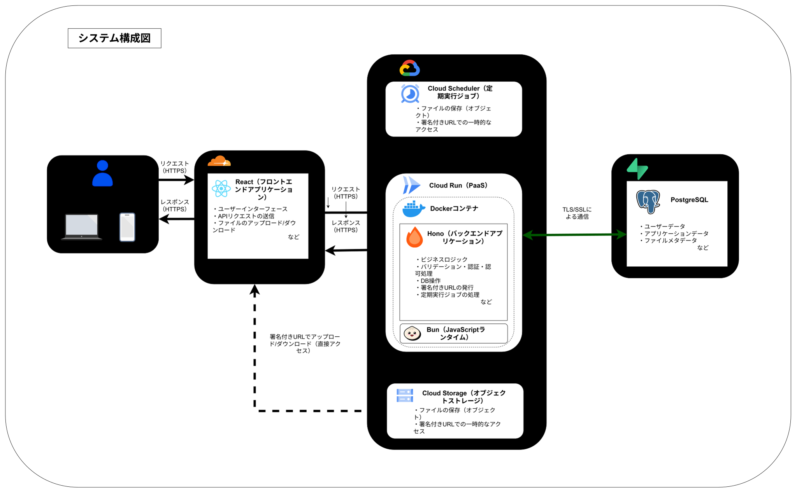

## プロジェクトの構成とデプロイフロー

このプロジェクトの構成は、フロントエンドとバックエンドが1つのリポジトリにまとめられるモノレポ構成となっています。
apps/webがフロントエンドアプリケーション、apps/serverがバックエンドアプリケーションに該当し、それぞれビルドされた後の成果物がCloudflare、Google Cloud Runにデプロイされます。
```
lms-repo-with-hono-and-tanstack/
├──.github/
|   └── workflows/   # GitHub Actionsのワークフロー
├── apps/
|   ├── web/         # フロントエンドアプリケーション (React + TanStack Router)
|   └── server/      # バックエンドアプリケーション (Hono)
├── packages/
|   |── api/         # APIルート（Hono）
|   |── auth/        # 認証・認可ロジック（Better Auth）
|   |── config/      # packages/の共通設定
|   |── db/          # データベース（postgres）のスキーマとクエリ
|   |── emails/      # メールテンプレートとResendのインスタンス生成
|   |── env/         # 環境変数の設定
|   |── shared/      # プロジェクト全体で使用するユーティリティ関数など
|   └── ui/          # Hero UIベースのコンポーネント
|
├── docker/
|   ├── docker-compose.dev.yml  # Docker Composeの開発環境設定ファイル
|   └── docker-compose.test.yml  # Docker Composeのテスト環境設定ファイル
|   ...
|   ...
|
├── biome.json       # Biomeの設定ファイル
├── bun.lock         # Bunの依存関係ロックファイル
├── package.json     # ルートのパッケージ設定
├── turbo.json       # Turborepoの設定ファイル
└── wrangler.jsonc   # Cloudflare Pagesの設定ファイル
```

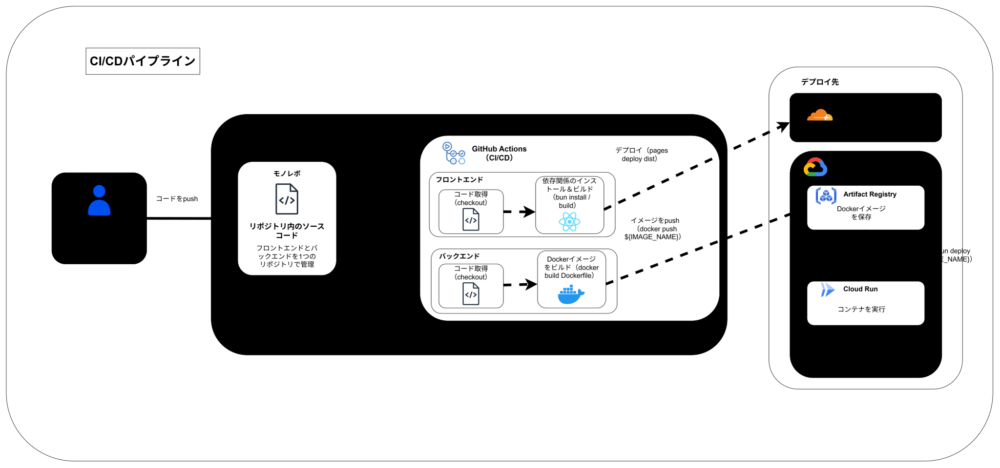

## 画面構成図

このWebアプリケーションの画面構成図（サイトマップ）は以下のようになります。サイト全体を「ランディングページ → カテゴリページ」の階層で整理し、URLに親子関係があるなら、サブページを`$`で表現します。図中の`$course-id`・`$assignment-id`はそれぞれ動的に変化する講義IDと課題IDを示すパスパラメータです。この画面構成図は機能単位（認証関連・学生用・教員用）でまとめられたWebページ群とそれらをリンクするヘッダメニューやボタンのみを表示しています。ボタンをクリックすることで指定されたリンクへ遷移するというシンプルな画面遷移のみを示しており、これはTanstack Routerにおいては`<Link />`コンポーネントで実装される部分にあたります。一方、副作用を伴うナビゲーション、すなわち`navigate()`、`redirect()`によるナビゲーションは次の画面遷移図で示します。

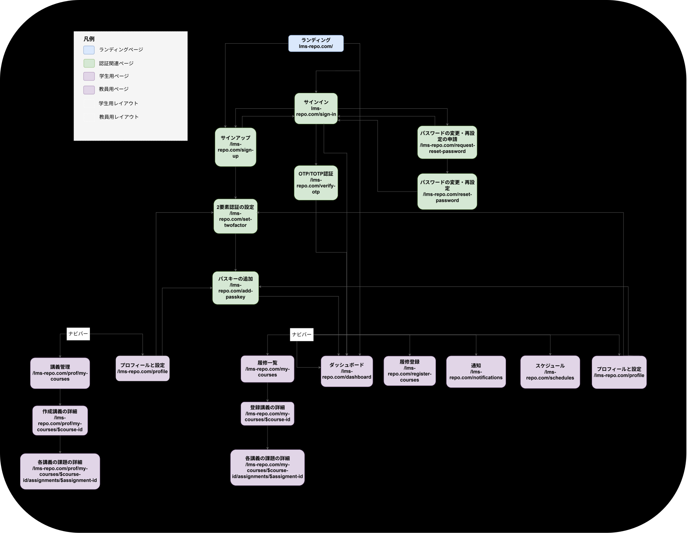

## 画面遷移図

画面間の遷移をユースケース別に示します。実際のルートファイル内の `navigate()`、`redirect()`、`Link` の記述に基づいています。ただし、`<Link />`コンポーネントによるナビゲーションは画面構成図に作図されているので、ここでは単に「リンク」と簡略化して表示します。

### 認証関連フロー（サインアップ、サインイン、パスワード再設定）

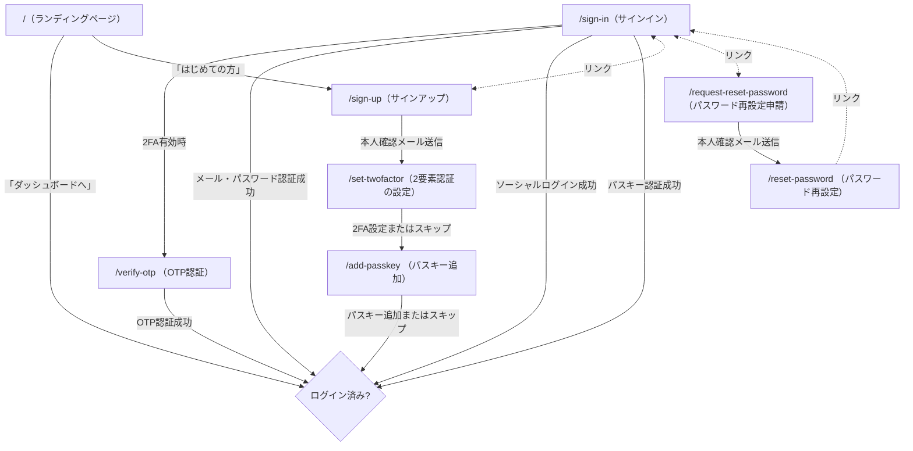

### ロールによる画面振り分け

ログイン後はユーザーの `role`（student / professor）に応じて遷移先が分岐します。`_my-page`配下は未ログイン時に `/sign-in` へリダイレクトされます。

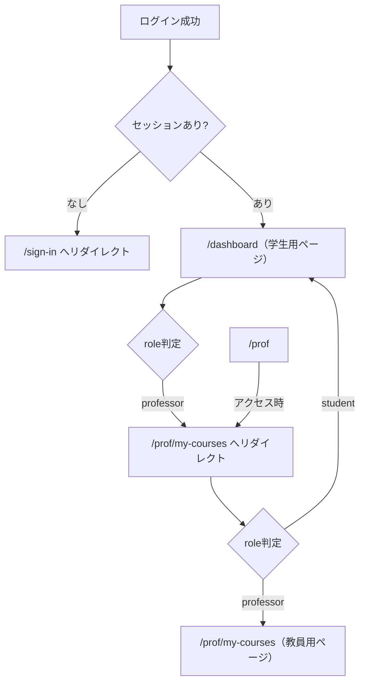

### 学生ユーザーのフロー

ヘッダーメニューから各画面へ遷移します。講義詳細→課題詳細（提出）の順にドリルダウンします。

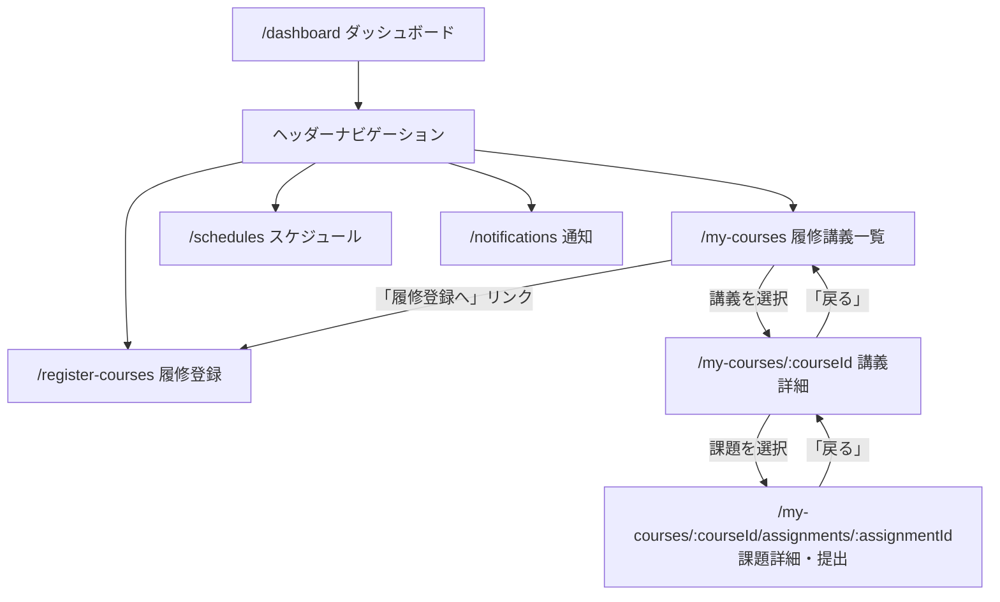

### 教員ユーザーのフロー

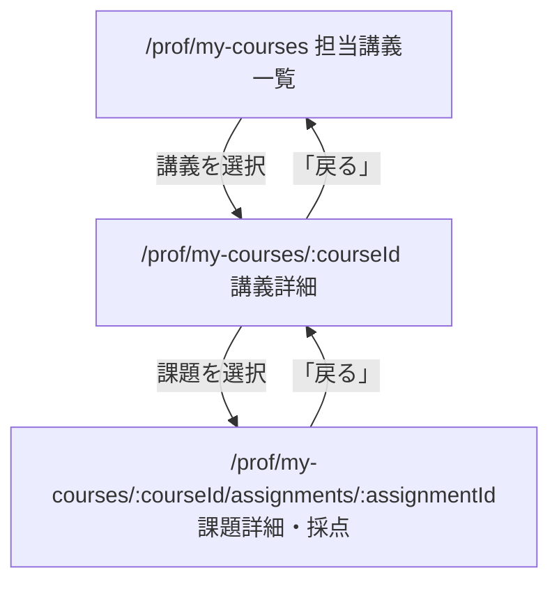

## 外部連携（WebAPI）仕様書

フロントエンド（`apps/web`）とバックエンド（`apps/server`）間のAPI仕様です。Hono RPC（`packages/api`）で提供され、ベースパスは `/api` です。

### 共通仕様

- **認証**：Better-AuthのセッションCookieを使用します。`/api/auth/*` はBetter-Authが処理し、その他の `/api/*` エンドポイントは認証ミドルウェアによりセッションが必須です（未認証時は `401 {"error": "not authenticated"}`）
- **認可**：エンドポイントごとに `student` / `professor` / `admin` のロール制限、および講義・課題へのアクセス権チェック（`requireRole`、`requireCourseAccess`、`requireAssignmentAccess`）を行います。権限不足時は `403` または `404` を返します
- **バリデーション**：リクエストボディ・クエリはZodスキーマで検証し、失敗時は複数のエラーがある場合、最初のエラーのメッセージを `400 {"error": "<最初のエラーメッセージ>"}` として返します
- **公開エンドポイント**：`POST /api/notifications/reminder` のみ認証不要で、Google Cloud SchedulerからのOIDCトークンで保護されます
- **ファイルアップロード**：本番環境では署名付きURL（GCS）を発行する方式を採用しています。`GCS_EMULATOR_HOST` 設定時は開発用のプロキシ／フォームアップロードAPIが有効になります

### 認証API（Better-Auth）

`/api/auth/*` はBetter-Authが処理します。主なエンドポイントは以下の通りです。

| API名                    | メソッド | パス                      | リクエストパラメータ        | レスポンス                                        | 機能概要                                                                                                  |
| ------------------------ | -------- | ------------------------- | --------------------------- | ------------------------------------------------- | --------------------------------------------------------------------------------------------------------- |
| メールアドレスでログイン | POST     | /api/auth/sign-in/email   | body: email, password       | 200: セッション / 2FA有効時は `twoFactorRedirect` | メールアドレスとパスワードで認証しセッションを発行します。二要素認証が有効な場合はOTP認証画面へ誘導します |
| 新規ユーザー登録         | POST     | /api/auth/sign-up/email   | body: email, password, name | 200: ユーザー作成                                 | メールアドレス・パスワード・氏名を指定してアカウントを新規作成します                                      |
| セッション取得           | GET      | /api/auth/get-session     | なし（Cookie）              | 200: セッション情報 / 401                         | 現在ログイン中のセッション情報（ユーザー・ロール等）を取得します                                          |
| パスキーでログイン       | POST     | /api/auth/sign-in/passkey | なし                        | 200: セッション / 401                             | 登録済みパスキーを用いたパスワードレス認証でログインします                                                |
| 二要素認証               | POST     | /api/auth/two-factor/*    | OTP・バックアップコード等   | 200: 検証結果                                     | TOTPまたはバックアップコードによる二要素認証を実行します                                                  |

### 講義（/api/courses）

| API名            | メソッド | パス                               | リクエストパラメータ                                                                                                  | レスポンス                                | 機能概要                                         |
| ---------------- | -------- | ---------------------------------- | --------------------------------------------------------------------------------------------------------------------- | ----------------------------------------- | ------------------------------------------------ |
| 講義作成         | POST     | /api/courses                       | body: name, targetGrade(1-4), weekdays(月-金), period(1-5), credits(1-4), requirements(必修/選択必修/任意), classRoom | 201: 作成結果 / 400: バリデーションエラー | 教員が担当学科の講義を新規作成します             |
| 作成講義一覧取得 | GET      | /api/courses/creations             | なし                                                                                                                  | 200: 自身が作成した講義一覧               | ログイン中の教員が作成した講義の一覧を取得します |
| 講義検索         | GET      | /api/courses                       | query: weekdays, period, limit, offset                                                                                | 200: 講義一覧（ページネーション）         | 曜日・時限で絞り込んだ講義を検索します           |
| 修了単位数取得   | GET      | /api/courses/completed-credits     | なし                                                                                                                  | 200: 修了済み単位数の合計                 | 学生が修了した講義の単位数合計を取得します       |
| 履修メンバー取得 | GET      | /api/courses/:course-id/members    | path: course-id                                                                                                       | 200: 履修メンバー一覧                     | 指定した講義を履修している学生の一覧を取得します |
| 履修登録         | POST     | /api/courses/:course-id/register   | path: course-id                                                                                                       | 200: 履修登録結果                         | 学生が講義の履修を登録します                     |
| 履修解除         | DELETE   | /api/courses/:course-id/unregister | path: course-id                                                                                                       | 200: 履修解除結果                         | 学生が講義の履修登録を取り消します               |
| 履修講義一覧取得 | GET      | /api/courses/registrations         | なし                                                                                                                  | 200: 履修登録済み講義一覧                 | 学生が履修登録している講義の一覧を取得します     |
| 履修確定         | PATCH    | /api/courses/registrations/confirm | なし                                                                                                                  | 200: 履修確定結果                         | 仮登録状態の履修を確定します                     |

### アナウンスメント（/api/courses/:course-id/announcements）

| API名                    | メソッド | パス                                  | リクエストパラメータ                                                    | レスポンス                                | 機能概要                                                 |
| ------------------------ | -------- | ------------------------------------- | ----------------------------------------------------------------------- | ----------------------------------------- | -------------------------------------------------------- |
| アナウンスメント作成     | POST     | /api/courses/:course-id/announcements | path: course-id, body: title, description, type(資料/アンケート/その他) | 201: 作成メッセージ（登録者へメール送信） | 講義に関するお知らせを作成し、履修学生へメール通知します |
| アナウンスメント一覧取得 | GET      | /api/courses/:course-id/announcements | path: course-id                                                         | 200: アナウンスメント一覧                 | 指定した講義のお知らせ一覧を取得します                   |

### 課題（/api/courses/:course-id/assignments）

| API名        | メソッド | パス                                               | リクエストパラメータ                                                                                            | レスポンス                                | 機能概要                                       |
| ------------ | -------- | -------------------------------------------------- | --------------------------------------------------------------------------------------------------------------- | ----------------------------------------- | ---------------------------------------------- |
| 課題作成     | POST     | /api/courses/:course-id/assignments                | path: course-id, body: title, description, points(0-100), dueDate(未来), format(text/pdf/excel/word/powerpoint) | 201: 作成メッセージ（登録者へメール送信） | 講義の課題を作成し、履修学生へメール通知します |
| 課題一覧取得 | GET      | /api/courses/:course-id/assignments                | path: course-id                                                                                                 | 200: 課題一覧                             | 指定した講義の課題一覧を取得します             |
| 課題詳細取得 | GET      | /api/courses/:course-id/assignments/:assignment-id | path: course-id, assignment-id                                                                                  | 200: 課題詳細                             | 指定した課題の詳細情報を取得します             |

### コメント（/api/courses/:course-id/assignments/:assignment-id/comments）

| API名            | メソッド | パス                                                        | リクエストパラメータ                                     | レスポンス        | 機能概要                                   |
| ---------------- | -------- | ----------------------------------------------------------- | -------------------------------------------------------- | ----------------- | ------------------------------------------ |
| コメント投稿     | POST     | /api/courses/:course-id/assignments/:assignment-id/comments | path: course-id, assignment-id, body: content(1-500文字) | 201: 作成結果     | 課題に対してコメントを投稿します           |
| コメント一覧取得 | GET      | /api/courses/:course-id/assignments/:assignment-id/comments | path: course-id, assignment-id                           | 200: コメント一覧 | 課題に投稿されたコメントの一覧を取得します |

### 提出物（/api/courses/:course-id/assignments/:assignment-id/submissions）

学生の提出は「署名付きURL発行 → GCSへ直接アップロード → メタデータ登録」の3段階で行います。

| API名                          | メソッド | パス                                                                              | リクエストパラメータ                                                                                   | レスポンス                                            | 機能概要                                                                     |
| ------------------------------ | -------- | --------------------------------------------------------------------------------- | ------------------------------------------------------------------------------------------------------ | ----------------------------------------------------- | ---------------------------------------------------------------------------- |
| 署名付きURL発行                | POST     | /api/courses/:course-id/assignments/:assignment-id/submissions/signed-urls        | path: course-id, assignment-id, body: [{fileName, fileType}]                                           | 200: [{fileName, signedUrl, objectName}]（15分有効）  | GCSへの直接アップロード用の署名付きURLを一括発行します                       |
| ファイルアップロード（開発用） | POST     | /api/courses/:course-id/assignments/:assignment-id/submissions/upload             | path: course-id, assignment-id, form: files（開発用エミュレータ）                                      | 200: アップロード済みメタデータ一覧                   | GCSエミュレータ環境でファイルを直接アップロードします                        |
| 提出メタデータ登録             | POST     | /api/courses/:course-id/assignments/:assignment-id/submissions/files              | path: course-id, assignment-id, body: {metadataList: [{objectName, originalName, mimeType, fileSize}]} | 200: 登録結果（ステータスを提出済みに更新）           | アップロード済みファイルのメタデータを一括登録し、提出ステータスを更新します |
| 提出ファイル一覧取得           | GET      | /api/courses/:course-id/assignments/:assignment-id/submissions/files              | path: course-id, assignment-id                                                                         | 200: 自身のファイルメタデータ一覧                     | ログイン中の学生が提出したファイルのメタデータ一覧を取得します               |
| ダウンロードURL発行            | GET      | /api/courses/:course-id/assignments/:assignment-id/submissions/files/:id/download | path: course-id, assignment-id, id                                                                     | 200: {signedUrl, fileName}（15分有効）                | 提出ファイルのダウンロード用署名付きURLを発行します                          |
| ファイルプロキシ取得（開発用） | GET      | /api/courses/:course-id/assignments/:assignment-id/submissions/files/:id/proxy    | path: course-id, assignment-id, id                                                                     | 200: ファイル本体（開発用エミュレータ）               | GCSエミュレータ環境でファイル本体をプロキシ配信します                        |
| ファイル削除                   | DELETE   | /api/courses/:course-id/assignments/:assignment-id/submissions/files/:id          | path: course-id, assignment-id, id                                                                     | 200: 削除結果                                         | GCS上のファイルとメタデータを削除し、提出ステータスを同期します              |
| テキスト提出                   | POST     | /api/courses/:course-id/assignments/:assignment-id/submissions/text               | path: course-id, assignment-id, body: {title, description}                                             | 200: 登録結果（ステータスを提出済みに更新）           | テキスト形式で課題を提出します                                               |
| テキスト提出取得               | GET      | /api/courses/:course-id/assignments/:assignment-id/submissions/text               | path: course-id, assignment-id                                                                         | 200: 自身のテキスト提出物                             | ログイン中の学生のテキスト提出物を取得します                                 |
| テキスト提出削除               | DELETE   | /api/courses/:course-id/assignments/:assignment-id/submissions/text/:id           | path: course-id, assignment-id, id                                                                     | 200: 削除結果                                         | テキスト提出物を削除し、提出ステータスを同期します                           |
| 提出ステータス取得             | GET      | /api/courses/:course-id/assignments/:assignment-id/submissions/status             | path: course-id, assignment-id                                                                         | 200: 提出ステータス（未提出/提出済み/評定済み・点数） | 課題に対する自身の提出ステータスを取得します                                 |
| 全提出物一覧取得               | GET      | /api/courses/:course-id/assignments/:assignment-id/submissions                    | query: limit, offset                                                                                   | 200: 全学生の提出物一覧（無限スクロール）             | 課題に対する全学生の提出物をページネーションで取得します                     |
| 採点                           | POST     | /api/courses/:course-id/assignments/:assignment-id/submissions/grade              | path: course-id, assignment-id, body: {userId, score}                                                  | 200: 採点結果 / 400: 配点超過                         | 教員が学生の提出物に点数を付けます                                           |

### ダッシュボード（/api/dashboard）

| API名                        | メソッド | パス                   | リクエストパラメータ | レスポンス                                                               | 機能概要                                               |
| ---------------------------- | -------- | ---------------------- | -------------------- | ------------------------------------------------------------------------ | ------------------------------------------------------ |
| ダッシュボード集約データ取得 | GET      | /api/dashboard/summary | なし                 | 200: {registrations, schedules, notifications, assignments, submissions} | 学生ダッシュボードに必要なデータを一括で集約取得します |

### 通知（/api/notifications）

| API名            | メソッド | パス                                             | リクエストパラメータ                    | レスポンス                        | 機能概要                                                                                            |
| ---------------- | -------- | ------------------------------------------------ | --------------------------------------- | --------------------------------- | --------------------------------------------------------------------------------------------------- |
| 通知一覧取得     | GET      | /api/notifications                               | query: limit, offset                    | 200: 通知一覧（ページネーション） | ログイン中のユーザー宛の通知をページネーションで取得します                                          |
| 通知件数取得     | GET      | /api/notifications/count                         | query: filter(all/unread/read, 任意)    | 200: 通知件数                     | フィルタ条件に応じた通知の件数を取得します                                                          |
| 全通知既読       | PATCH    | /api/notifications/mark-as-read                  | なし                                    | 200: 全通知を既読に更新           | 未読の通知をすべて既読にします                                                                      |
| 通知既読         | PATCH    | /api/notifications/:notification-id/mark-as-read | path: notification-id                   | 200: 指定通知を既読に更新         | 指定した通知を既読にします                                                                          |
| 通知削除         | DELETE   | /api/notifications/:notification-id              | path: notification-id（省略時は全削除） | 200: 削除結果                     | 指定した通知（省略時は全件）を削除します                                                            |
| リマインダー作成 | POST     | /api/notifications/reminder                      | なし（OIDC認証）                        | 201: リマインダー作成＋メール送信 | 期限が近い課題のリマインダーを作成し、対象ユーザーへメール送信します（Cloud Schedulerから定期実行） |

### 教員プロフィール（/api/professors）

| API名                | メソッド | パス                       | リクエストパラメータ | レスポンス                          | 機能概要                                       |
| -------------------- | -------- | -------------------------- | -------------------- | ----------------------------------- | ---------------------------------------------- |
| 教員所属登録         | POST     | /api/professors/me/profile | body: departmentName | 201: 登録結果                       | 教員が所属する学科を登録します                 |
| 教員プロフィール取得 | GET      | /api/professors/me/profile | なし                 | 200: プロフィール情報 / 404: 未登録 | ログイン中の教員のプロフィール情報を取得します |

### スケジュール（/api/schedules）

| API名                  | メソッド | パス                        | リクエストパラメータ                                                                       | レスポンス                  | 機能概要                                                   |
| ---------------------- | -------- | --------------------------- | ------------------------------------------------------------------------------------------ | --------------------------- | ---------------------------------------------------------- |
| スケジュール作成・更新 | POST     | /api/schedules              | body: id(任意・指定時は更新), title, description, startTime, endTime, theme(#RRGGBB, 任意) | 200: 作成/更新結果          | スケジュールを新規作成または更新します                     |
| スケジュール一覧取得   | GET      | /api/schedules              | なし                                                                                       | 200: 自身のスケジュール一覧 | ログイン中のユーザーが作成したスケジュール一覧を取得します |
| スケジュール削除       | DELETE   | /api/schedules/:schedule-id | path: schedule-id                                                                          | 200: 削除結果               | 指定したスケジュールを削除します                           |

### 設定（/api/settings）

| API名              | メソッド | パス                             | リクエストパラメータ                                                                             | レスポンス          | 機能概要                             |
| ------------------ | -------- | -------------------------------- | ------------------------------------------------------------------------------------------------ | ------------------- | ------------------------------------ |
| メール通知設定更新 | POST     | /api/settings/email-notification | body: {announcementsEmail, assignmentsEmail, submissionsEmail, evaluationsEmail, remindersEmail} | 200: 更新結果       | 各種通知のメール受信設定を更新します |
| メール通知設定取得 | GET      | /api/settings/email-notification | なし                                                                                             | 200: メール通知設定 | 現在のメール通知設定を取得します     |

### 学生プロフィール・ロール変更（/api/students）

| API名                | メソッド | パス                                 | リクエストパラメータ             | レスポンス                                    | 機能概要                                                 |
| -------------------- | -------- | ------------------------------------ | -------------------------------- | --------------------------------------------- | -------------------------------------------------------- |
| ロール変更申請       | POST     | /api/students/me/role-change-request | なし                             | 200: 申請完了メッセージ（管理者へメール送信） | 学生が教員アカウントへの変更を申請し、管理者へ通知します |
| 学生所属登録         | POST     | /api/students/me/profile             | body: grade(1-4), departmentName | 201: 登録結果                                 | 学生の学年と所属学科を登録します                         |
| 学生プロフィール取得 | GET      | /api/students/me/profile             | なし                             | 200: 学生情報 / 404: 未登録                   | ログイン中の学生のプロフィール情報を取得します           |

## ER図

データベースの論理設計について説明します。packages/db内にはこのWebアプリケーションで使用するデータベースのスキーマが定義されています。drizzle ORMを使って、TypeScriptで2つのスキーマ「better_auth」、「public」が記述されています。「better_auth」は認証情報（ユーザー、セッション、トークンなど）を格納するスキーマで、「public」はアプリケーションの主要な業務データ（講義、課題、スケジュールなど）を格納するデフォルトのスキーマです。前者は認証・認可ライブラリのBetter-Authが提供するスキーマであり、以下のコマンドで生成されます（Better-Auth公式ドキュメント参照: https://better-auth.com/docs/concepts/cli ）。

```bash
bun x auth@latest generate
```

以下に各スキーマのER図を示します。ER図はIE記法で表現しています。`PK`は主キー、`FK`は外部キー、`UK`は一意制約を示します。なお、`REGISTRATION`、`SUBMISSION_STATUS`、`USER_NOTIFICATIONS`は複合主キーを持つテーブルです。

### better_authスキーマ（認証・認可）

Better-Authが提供する認証関連テーブルです。前述したコマンドを実行することで生成されるため、手動で編集する必要はありませんが、userテーブルのroleカラムに独自のcheck制約を追加しています。

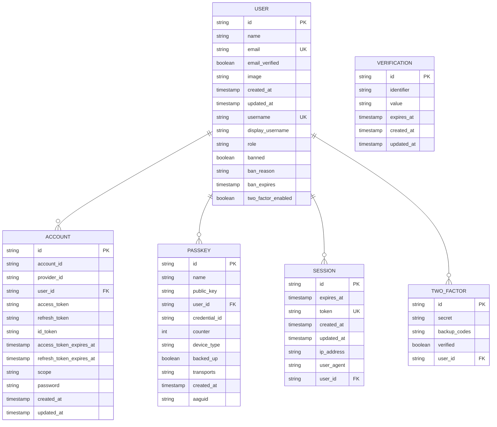

### publicスキーマ（業務データ）

学部・学科・ユーザー属性・講義・課題・提出物・通知・スケジュールなどの業務テーブル（計16テーブル）です。見やすさのため、ドメインごとに3つの図に分割しています。`USER`は`better_auth`スキーマのテーブルであり、各所で`user.id`を参照します。図中で他の図に属するテーブルは、参照関係を示すため主キーのみを記載した簡易表現としています。

#### 組織・ユーザー

大学の組織構造（学部→学科）と、学生・教員のユーザー属性、メール通知設定を管理するテーブル群です。DDL上では親子関係のある子テーブルの外部キーにNotNull制約が設定されていますが、業務上の制約に従って1:0..Nと1:1..Nを区別しています。1つの学部には最低1つの学科が存在し、1つの学科には最低1人の教員が所属するというのは自然だと思います。したがって、学部-学科、学科-教員の関係は1:1..Nとしています。一方、学生が1人も所属しない学科が存在する可能性は現実的に極めて低いですが、学科-学生の関係は1:0..Nとしています。ユーザー-学生とユーザー-教員の関係については、ユーザーはどちらか一方にしか属さないため1:0..1で表現します。論理設計と物理設計にわずかな違いがありますが、あくまでもER図は業務上の制約を正確に表現することを重視しています。

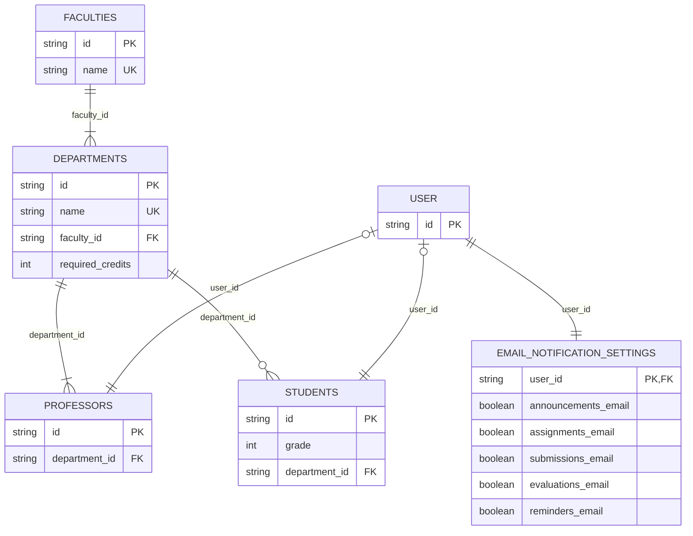

#### 講義・課題・提出物

講義情報、履修登録、アナウンスメント、課題とその提出物（テキスト・ファイル）、コメント、提出状況を管理するテーブル群です。ここでも先ほどと同様に業務上の制約に従って1:0..Nと1:1..Nを区別しています。1つの学科に属する講義は必ず1つ以上存在し、教員は自身が担当する講義を複数受け持つことができるため、学科-講義と教員-講義はともに1:1..1です。また、提出状況は「未提出」「提出済」「採点済」の3状態のどれかであり、ユーザーごと、課題ごとに1件の提出状況レコードを持つため、ユーザー-提出状況と課題-提出状況は1:1..Nです。その他のテーブル間の関係はすべて1:0..Nです。

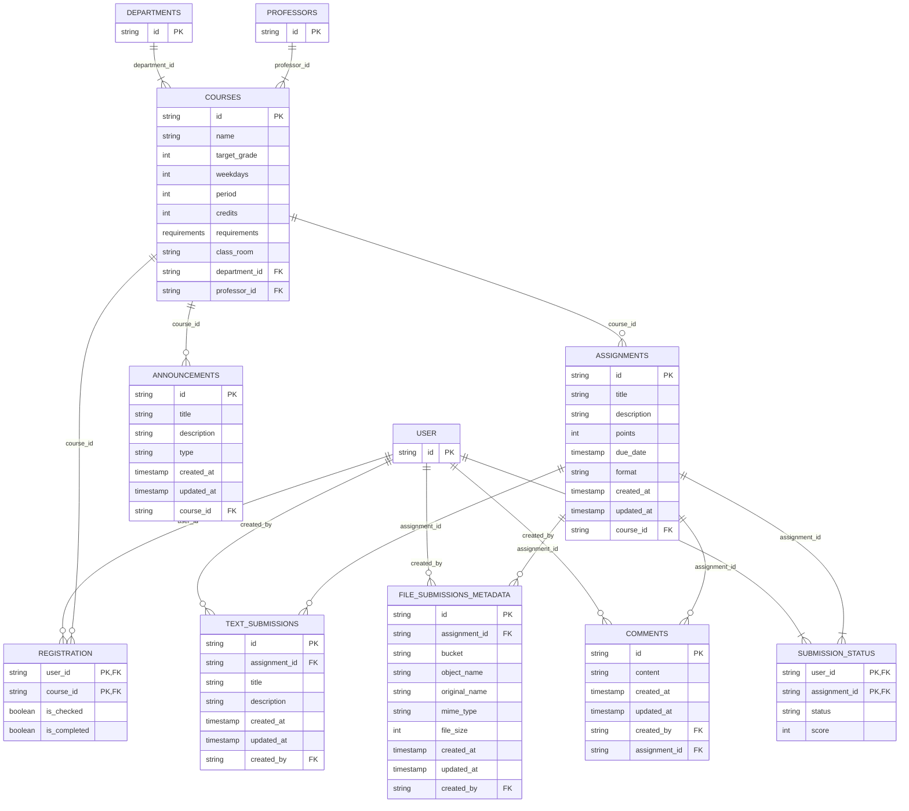

#### 通知・スケジュール

お知らせ通知と、ユーザーが作成するスケジュールを管理するテーブル群です。

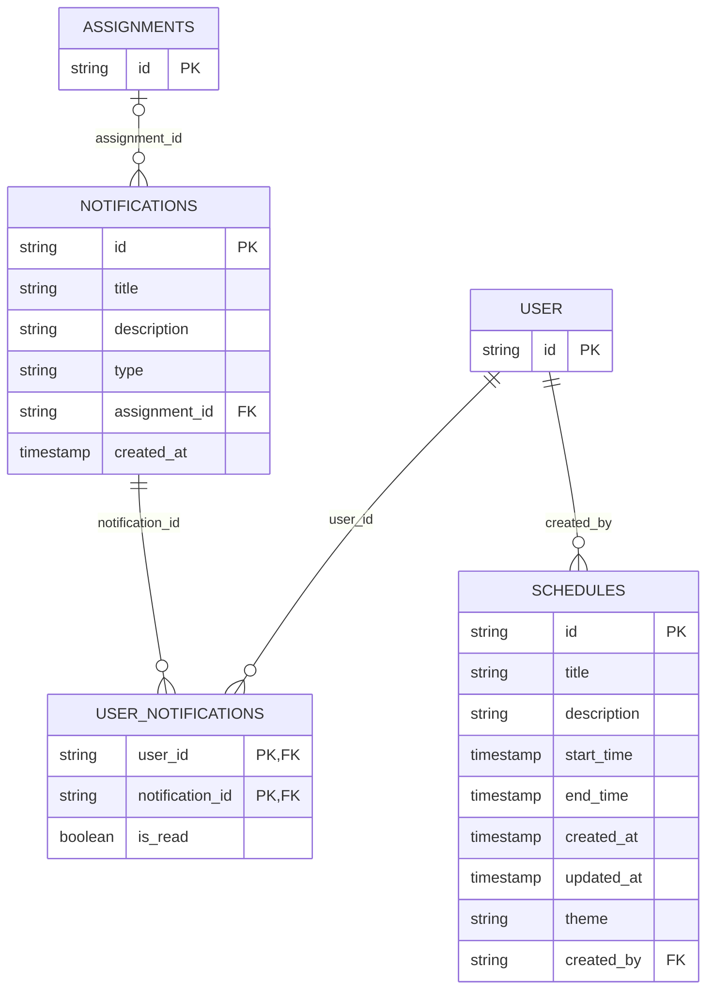

## ローカル環境での起動方法

あらかじめBunをグローバルインストールしておく必要があります。Bunのインストールについては公式ドキュメントを参照してください。ホストにプロジェクトをクローンした後、以下のコマンドを実行してください。

```bash
bun install
```

WSL2環境で依存パッケージのインストールが失敗する場合、/etc/wsl.conf に

```ini
[interop]
appendWindowsPath = false
```

を追加し、
`wsl --shutdown`
でwslを再起動してみてください。

インストールが完了したら、以下のコマンドを実行することで開発サーバーを起動できます。

```bash
bun run dev
```
本プロジェクトではPostgreSQLデータベースを使用するので、その構築も行います。Dockerコンテナ上でPostgreSQLを起動するため、事前にDockerをインストールしておく必要があります。インストール済みの場合は、必要な環境変数を記述した.env.db.devファイルをpackages/dbに作成し、以下のコマンドを実行してデータベースを起動します。

```bash
bun run docker:up
```

このコマンドにより、`docker/docker-compose.dev.yml` に定義されたDockerコンテナが起動します。なお、データベースだけでなく開発環境で疑似的にファイルのアップロードやダウンロードを行うためのGCSエミュレータも起動します。スキーマの作成とマイグレーションを行うには、以下のコマンドを実行してください。

スキーマの生成

```bash
bun run db:generate
```

スキーマのマイグレーション

```bash
bun run db:migrate
```

マイグレーションが完了したら、初期データ（モックデータ）をデータベースに挿入します。

```bash
bun run db:seed
```

以上のセットアップによって、開発環境を再現できます（Windows, WSL2でのみ検証済み）。

## 技術選定の理由

以下では、開発者自身の視点で技術選定の理由や工夫した点、苦労した点、反省点などを記述します。
まずは、技術選定の理由についてです。上記に示した技術構成に至るまで何度も練り直しを行いましたが、選定の判断軸となっていたものを挙げると次のようになります。
1. サービスの運用コストがほぼゼロである
2. 自分の技術スキルに照らして学習コスト（開発コスト）が低い
3. 流行りの技術あるいは広く開発者に使われている技術である
4. 型安全性が高い
5. 汎用性の高い技術である
6. 疎結合性が高い
7. 標準化されている
8. エコシステムが充実している
9. パフォーマンスが良い
10. セキュリティが考慮されている

はじめにインフラ層について見ていきます。この層での技術選定で最も重視したのは1の予算制約です。Google CloudにはCloud SQLと呼ばれるマネージドRDBがありますが、有料のためSupabaseで代用しました。無料で利用できるクラウドデータベースは他にもありますが、Supabaseではリージョンを東京（asia-northeast1）に指定でき、Cloud RunやCloud Storageのリージョンと一致させることができます。このため、データ転送時のレイテンシを抑えることができるというメリットを享受できます。フロントエンドアプリケーションのデプロイ先として選んだCloudflareはパフォーマンスとセキュリティの面で優れています。Contents Delivery Network（CDN）による高速なコンテンツ配信が可能で、グローバルユーザーへのアクセス速度を向上させることができます。また、SSL/TLS証明書の自動発行・更新が可能で、Web Application Firewall（WAF）によるセキュリティ保護、DDoS攻撃セキュリティ保護、DDoS攻撃対策も提供されます。なお、Cloudflareは権威DNSサーバーとしても利用しています。  
アプリケーション層で使用するフレームワークにはReactやHonoを選びました。Reactはモダンなフロントエンド開発に適したライブラリであり、Honoは軽量で高速なWebフレームワークです。プロジェクト全体でTypeScriptを使用するなら、型安全性を高め、開発効率と保守性を両立させるうえでこの組み合わせが良いと考えました。このフルスタックアプリケーションはSingle Page Application（SPA）として設計されています。すなわち、サーバーサイド（Cloudflare）から単一のWebページを構成するHTML、CSS、JavaScriptを配信し、クライアントサイドにおいてユーザー操作に応じたデータの送受信やUIの更新を行います。SPAではHistoryAPIを使った画面遷移を実装するためにルーターが必要になります。このルーターにも選択肢が複数ありますが、型安全性の観点から優れているTanstack Routerを採用しました。SPAの画面描画はクライアント上で行われるため（CSR）、初期表示の遅さや検索エンジンにインデックスされにくいという問題があります。根本的な解決策にはならないですが、Tanstack Routerのプリフェッチ機能を活用することでユーザーがページ遷移する前に必要なデータを事前に取得し、表示を高速化することができます。クライアントからデータを取得したり、更新したりする際にはデータベースへアクセスする必要がありますが、この仲介をHonoで構築されたWeb APIが担います。Hono以外にも候補はありましたが、TypeScriptと相性がよく、軽量で高速、Web標準に準拠した設計であることからHonoを選択しました。サーバーサイドでJavaScriptを実行するためには、JavaScriptランタイムが必要です。このプロジェクトではBunを採用しました。運用実績やエコシステムの充実性を考慮するとNode.jsの方が優位ですが、新規の個人開発においてはBunの方が向いていると考えました。JavaScriptランタイムとしてだけではなく、パッケージマネージャーやビルドツールとしても利用できるため、開発効率を高めることができます。  
その他、開発ツールについてもいくつか言及します。Dockerは開発用のデータベースや

## 工夫した点・苦労した点

## 反省点と今後の展望
